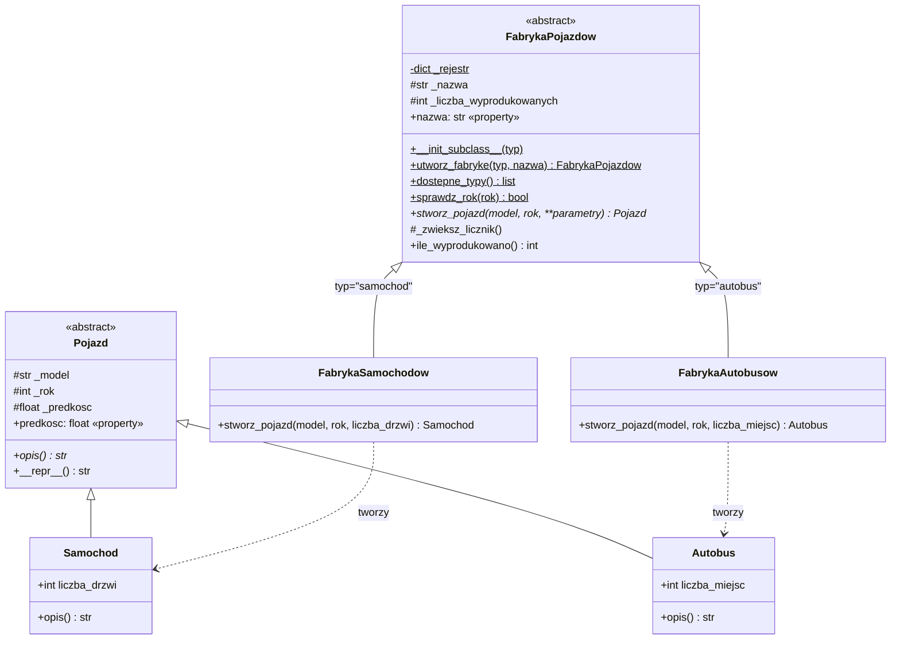
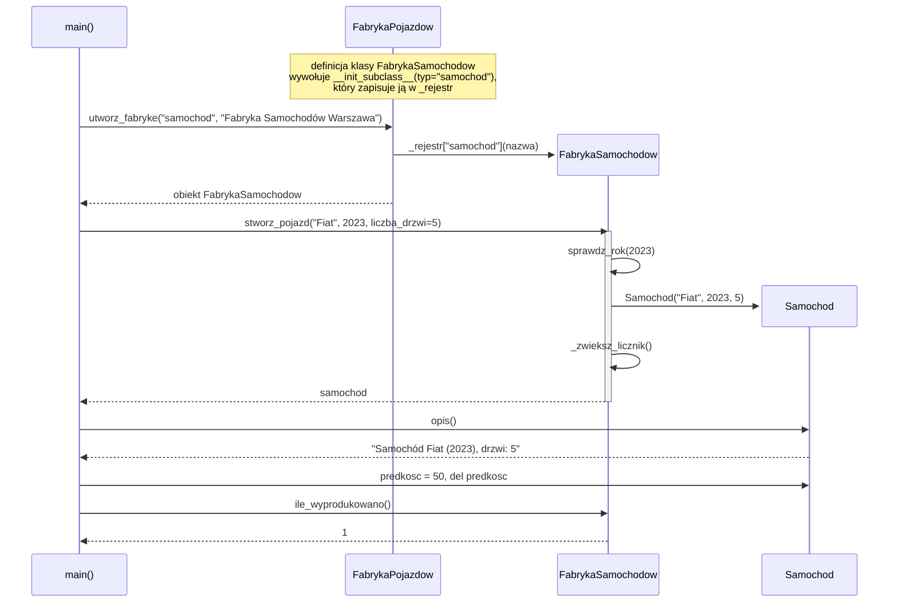

# Diagramy do zadania 2

Pliki `.mmd` to źródła diagramów w języku Mermaid (np. https://mermaid.live).
GitHub wyświetla poniższe diagramy bezpośrednio na stronie repozytorium.

## Diagram klas

## Diagram sekwencji: działanie main()

